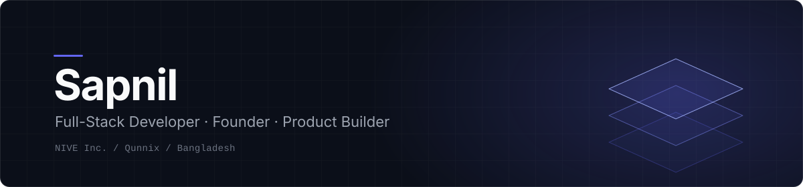
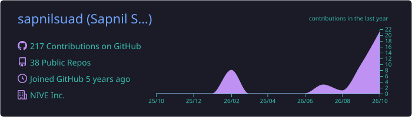
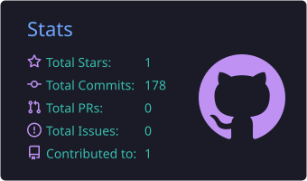
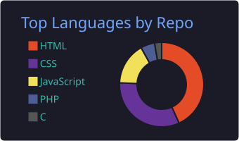
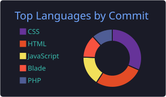
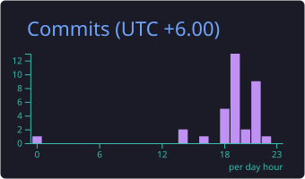

<div align="center">



<a href="https://github.com/sapnilsuad">
  
</a>

<br/>

[](https://qunnix.com)
[](https://qunnix.com)
[](https://github.com/sapnilsuad)
[](#)

</div>


## ✨ About Me

<table>
<tr>
<td width="55%" valign="top">

```js
const sapnil = {
  role:      "Full-Stack Developer & Founder",
  studying:  "Software Engineering",
  location:  "Bangladesh 🇧🇩",
  company:   "NIVE Inc.",
  building:  ["Qunnix", "QFlow", "Scanix"],
  stack:     ["PHP", "Laravel", "React", "MySQL"],
  focus:     ["Full-stack", "Product engineering", "Entrepreneurship"],
  mindset:   "Always learning. Always building.",
};
```

</td>
<td width="45%" valign="top">

I enjoy taking ideas from **concept to reality** — designing, developing, and shipping products that people can actually use.

🚀 Founder of **NIVE Inc.**
🌐 Building **[Qunnix](https://qunnix.com)**, a student-focused digital ecosystem
🧠 Constantly experimenting with new ideas

> *Building products, not just projects.*

</td>
</tr>
</table>


## 🛠️ Tech Stack

<div align="center">

<table>
<tr>
<td align="center" width="96"><br/><sub><b>PHP</b></sub></td>
<td align="center" width="96"><br/><sub><b>Laravel</b></sub></td>
<td align="center" width="96"><br/><sub><b>JavaScript</b></sub></td>
<td align="center" width="96"><br/><sub><b>React</b></sub></td>
<td align="center" width="96"><br/><sub><b>HTML5</b></sub></td>
</tr>
<tr>
<td align="center" width="96"><br/><sub><b>CSS3</b></sub></td>
<td align="center" width="96"><br/><sub><b>Bootstrap</b></sub></td>
<td align="center" width="96"><br/><sub><b>MySQL</b></sub></td>
<td align="center" width="96"><br/><sub><b>Git</b></sub></td>
<td align="center" width="96"><br/><sub><b>VS Code</b></sub></td>
</tr>
</table>

</div>


## 🚀 What I'm Building

<table>
<tr>
<td width="50%" valign="top">

### 🌐 [Qunnix](https://qunnix.com)
A student-focused digital ecosystem that connects students with **opportunities, resources, and meaningful connections.**

`Networking` `Academic tools` `Opportunities`

**[Explore Qunnix →](https://qunnix.com)**

</td>
<td width="50%" valign="top">

### ⚡ QFlow
A student organization and **class representative management** tool.

`Routines` `Tasks` `Notices` `Academic organization`

**Part of the Qunnix ecosystem**

</td>
</tr>
<tr>
<td width="50%" valign="top">

### 📄 Scanix
A simple tool for **turning images into PDF documents.**

`Productivity` `Student utility`

**Making everyday student tasks easier**

</td>
<td width="50%" valign="top">

### 🏢 NIVE Inc.
My software company, where **ideas turn into digital solutions.**

`Web development` `Software services`

**From concept to production**

</td>
</tr>
</table>


## 📊 GitHub Overview

<div align="center">

<table>
<tr>
<td align="center"></td>
<td align="center"></td>
</tr>
<tr>
<td align="center"></td>
<td align="center"></td>
</tr>
</table>



</div>

<br/>

### 🐍 Contribution Snake

<div align="center">
<picture>
  <source media="(prefers-color-scheme: dark)" srcset="https://raw.githubusercontent.com/sapnilsuad/sapnilsuad/output/github-snake-dark.svg" />
  <source media="(prefers-color-scheme: light)" srcset="https://raw.githubusercontent.com/sapnilsuad/sapnilsuad/output/github-snake.svg" />
  
</picture>
</div>


## 🤝 Let's Connect

I'm always up for connecting with **developers, founders, and people who love building meaningful things.**

<div align="center">

[](https://qunnix.com)
[](https://github.com/sapnilsuad)

</div>

<br/>


