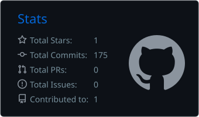
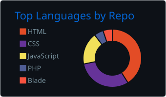
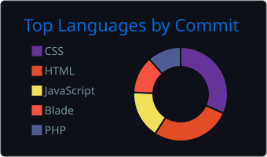

 

I'm a software engineering student and full-stack developer from Bangladesh. I take products from idea to production: data model, backend, interface, and everything between. I run **NIVE Inc.**, a software company, and I'm building **Qunnix**, a digital ecosystem for students.

 

## Projects

| | |
|:--|:--|
| **[Qunnix](https://qunnix.com)** | A student-focused digital ecosystem connecting students with opportunities, resources, and each other. |
| **QFlow** | Class and organization management for student representatives: routines, tasks, and notices. Part of the Qunnix ecosystem. |
| **Scanix** | A lightweight tool that converts images into PDF documents. |
| **NIVE Inc.** | Software company focused on web development and software services. |

 

## Stack

| | |
|:--|:--|
| **Backend** |    |
| **Frontend** |      |
| **Tooling** |    |

 

## Activity

<table>
<tr>
<td width="33%" valign="top"></td>
<td width="33%" valign="top"></td>
<td width="33%" valign="top"></td>
</tr>
</table>

<picture>
  <source media="(prefers-color-scheme: dark)" srcset="https://raw.githubusercontent.com/sapnilsuad/sapnilsuad/output/github-snake-dark.svg" />
  <source media="(prefers-color-scheme: light)" srcset="https://raw.githubusercontent.com/sapnilsuad/sapnilsuad/output/github-snake.svg" />
  
</picture>

 

## Contact

Open to conversations with developers, founders, and anyone building something worthwhile.

[qunnix.com](https://qunnix.com)  ·  [github.com/sapnilsuad](https://github.com/sapnilsuad)
